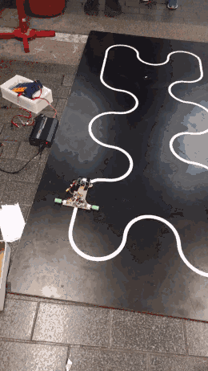
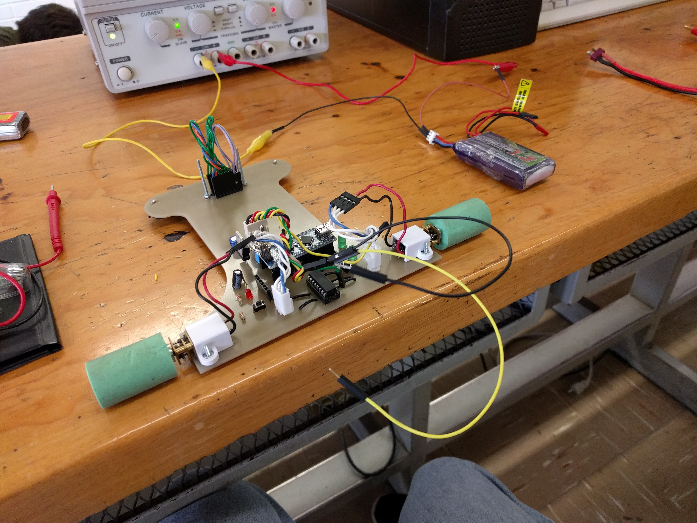
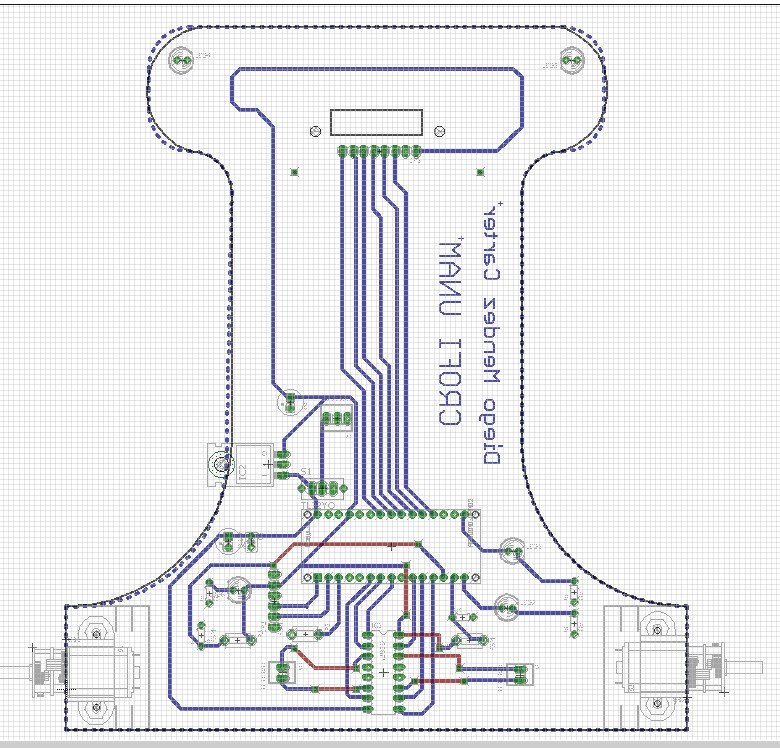

# 🔌 Arduino Nano Motor Driver Shield – Custom PCB for Robotics

> A compact, custom-designed motor driver shield for Arduino Nano, integrating dual DC motor control, button interface, voltage regulation, and status indicators – all in one PCB tailored for mobile robotic platforms.

---

## 📋 Project Summary

This project features a fully integrated, custom-designed PCB to interface an Arduino Nano with a mobile robot. It controls two DC motors using the L293D H-Bridge IC, reads user input from buttons, regulates power for logic levels, and provides visual feedback via status LEDs.

Designed for:
- Line followers
- Educational mobile platforms
- Mechatronics and robotics learning

---

## 🎯 Features

- ✅ **Arduino Nano socket support**
- ✅ **Dual motor control** via L293D
- ✅ **Integrated power regulation** with filtering capacitors
- ✅ **Push buttons + LED indicators**
- ✅ **Modular & reproducible PCB layout**
- ✅ **Designed in Autodesk Eagle**

---

## 📁 Repository Contents

| Folder/File       | Description                            |
|-------------------|----------------------------------------|
| `schematic/`      | Eagle schematic `.sch` file            |
| `board/`          | Eagle board layout `.brd` file         |
| `firmware/`       | Arduino sketch and control code        |
| `docs/images/`    | Schematic, PCB images, assembly photos |
| `README.md`       | Project documentation (this file)      |

---

## 📷 Preview & Track Tests

### 🏎️ Prototype Track Testing

### 🔧 Prototype Assembly & Bench Testing

### 📐 Schematic & Circuit Reference

## 🔧 CAD & PCB Layout

### 🔧 Schematic View

### 🖨️ PCB Layout

---

## 🧠 Skills Demonstrated

- Embedded system design (Arduino)
- PCB development using Eagle
- Power management and protection
- Integration of sensors and actuators
- Documentation for reproducibility

---

## 📜 License

This project is licensed under the [MIT License](LICENSE).

---

## ✍️ Author

**Diego Méndez Carter**  
Component Engineer | Robotics Enthusiast  
🔗 [LinkedIn](www.linkedin.com/in/diegomendezcarter)

---

> ⚙️ This project was developed as part of my academic portfolio for robotics and embedded systems, and supports my application to the Erasmus Mundus master's programme.
