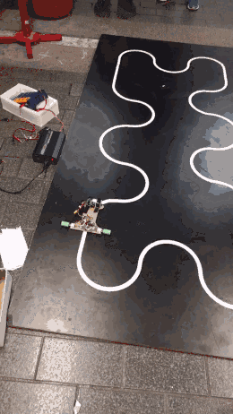
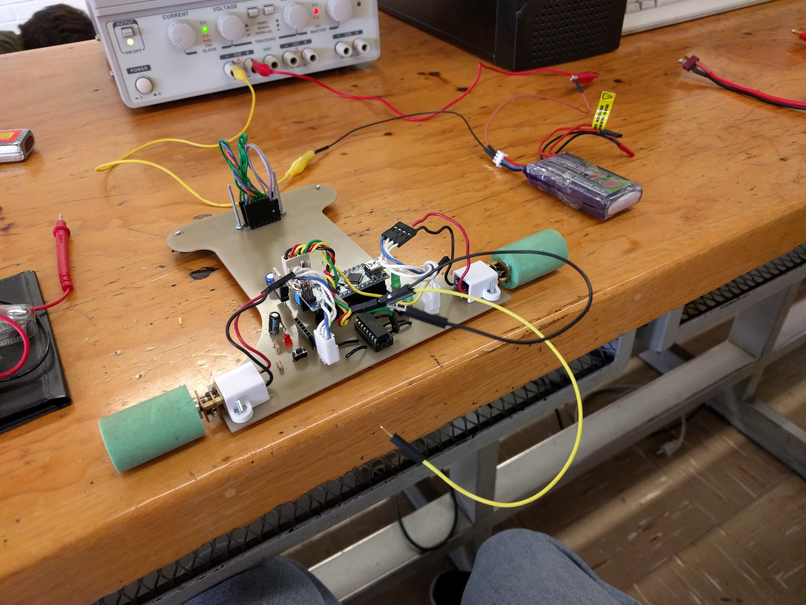

# Arduino Nano Motor Driver Shield & Line Follower

Compact printed circuit board shield designed for Arduino Nano mobile platforms, providing dual DC motor drive (L293D), integrated 5V voltage regulation, pushbutton interfaces, and status LEDs.

---

## Hardware Specifications

| Subsystem | Specification |
| :--- | :--- |
| **Microcontroller Socket** | Arduino Nano (modular 30-pin DIP footprint) |
| **Motor Driver** | L293D dual H-bridge (up to 600 mA continuous per channel) |
| **Input Supply** | 6V–12V DC input via screw terminals / DC jack |
| **Logic Regulation** | Onboard 5V linear regulator with decoupling capacitors (100 µF, 220 µF) |
| **User Interfaces** | 2 tactile pushbuttons, power indicator LED, activity LED |
| **EDA Tool** | Autodesk EAGLE |

---

## Prototype Testing & Media

### Track Evaluation & Bench Assembly
| Autonomous Track Run | Prototype Assembly |
| :---: | :---: |
|  |  |

### CAD & Circuit Design
| Schematic Diagram | PCB Layout |
| :---: | :---: |
|  |  |

---

## Repository Structure

- [`code/`](code/): Closed-loop PID tracking firmware for 6-channel analog IR reflectance sensor arrays.
- [`electronics/`](electronics/): Autodesk EAGLE schematic (`.sch`), board layout (`.brd`), and hardware pinout documentation.

---

## Author & License

- **Diego Méndez Carter**  
- Licensed under the [MIT License](LICENSE).
