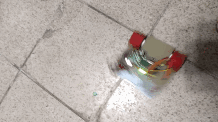

# 🤖 Minisumo & Soccer Junior Robots

> A retrospective showcase of two early robotics projects I built for competitions and learning, featuring full electronic and mechanical design. Although source code and files are no longer available, these builds represent key milestones in my development as a robotics engineer.

---

## 📸 Project Images

### 🏎️ 2018 Competition Robot Benchmark & Test Run

### 🟦 Minisumo Robot

### ⚽ Soccer Junior Prototype (ROS-based)

---

## 🧠 My Contributions

### 🔹 Minisumo Robot (2018)
- 🧩 **Electronics**: Designed and built fully standalone motor driver and control PCB (not Arduino-based).
- 🛠️ **Chassis**: Fully designed and assembled the robot structure using lightweight materials.
- ⚙️ **Tuning**: Manual calibration of motors and sensors for line sensing and sumo detection.
- 🏆 Used in regional robotics club tournaments.

---

### 🔹 Soccer Junior Robot (2018)
- 📦 **Chassis**: Fully custom 3D-printed & MDF-layered robot frame.
- 📐 **Electronics**: Built sensor and motor interfacing system (ultrasonic, IR encoders).
- 🤖 **ROS Integration**: My first attempt at using ROS to handle robot movement and perception.
  - Learned basics of ROS nodes, topics, and sensor integration.
  - Although the project had performance issues, it introduced me to robot middleware.

---

## 🧾 Notes

- These early builds shaped my passion for system integration and embedded control.
- Lessons from these prototypes led to better PCB design, ROS programming, and mechanical design in future projects.
- Even in the absence of code, I consider them formative experiences in multidisciplinary robotics.

---

## 🛠️ Technologies Used

- ⚙️ DC Motors, H-Bridge
- 🔋 LDO Regulators, custom PCB
- 🔊 Ultrasonic Sensors, IR Receivers
- 🛠️ 3D Printing, MDF prototyping
- 🧠 ROS (Robot Operating System)

---

## 👤 Author

**Diego Méndez Carter**  
Robotics Engineer | Embedded Systems | Early ROS Explorer  

---

## 📜 License

All media and content in this repository are released for personal documentation and educational purposes.

