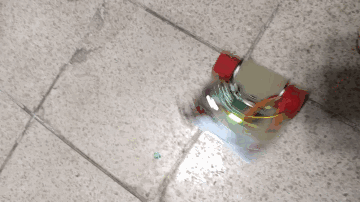

# Competition Mobile Robotics Prototypes (2018)

Technical and photographic archive of early competitive robotics platforms built at the Club de Robótica de la Facultad de Ingeniería (CROFI), UNAM.

---

## Prototype Archive

### 1. 2018 Competition Benchmark Platform
High-speed differential-drive test bench evaluating motor response curves, chassis balance, and reflective sensor timing.

---

### 2. Autonomous Minisumo Robot
Designed and built for university minisumo tournaments.

- **Electronics**: Standalone custom motor driver board (discrete MOSFET / transistor H-bridge, non-Arduino architecture).
- **Chassis**: Lightweight aluminum wedge frame for opponent lifting and traction maintenance.
- **Sensing**: Downward-facing phototransistors for ring border detection and frontal IR sensors for opponent localization.

---

### 3. Soccer Junior Robot Prototype
Autonomous mobile platform developed under RoboCup Junior soccer specifications.

- **Mechanical Design**: Layered 3D-printed components with an MDF core structure.
- **Sensor Suite**: Dual frontal ultrasonic rangefinders and optical wheel encoders.
- **Middleware**: Early integration of ROS nodes for wheel velocity setpoint dispatch and sensor polling.

---

## Hardware Specifications

- **Actuation**: Pololu micro metal gearmotors, L298N and discrete H-bridges.
- **Power**: 7.4V LiPo battery packs, linear LDO regulators (5V logic rail).
- **Sensing**: Ultrasonic transducers (HC-SR04), sharp analog IR distance sensors, QTR reflectance pairs.
- **Manufacturing**: 3D printing (PLA), laser-cut MDF, and machined aluminum.

---

## Author & License

- **Diego Méndez Carter**  
- Shared under the [MIT License](LICENSE) for technical portfolio reference.
